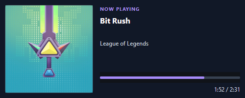
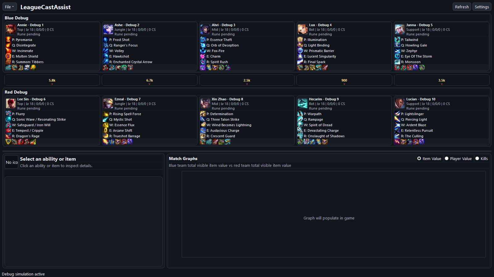
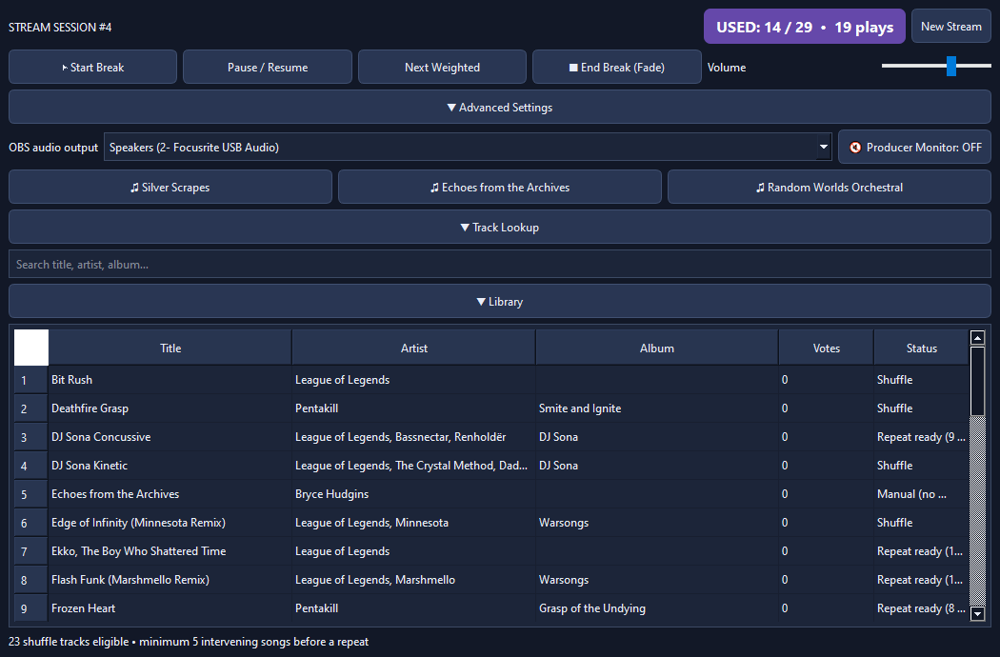
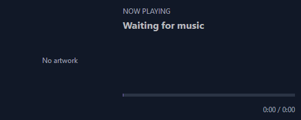
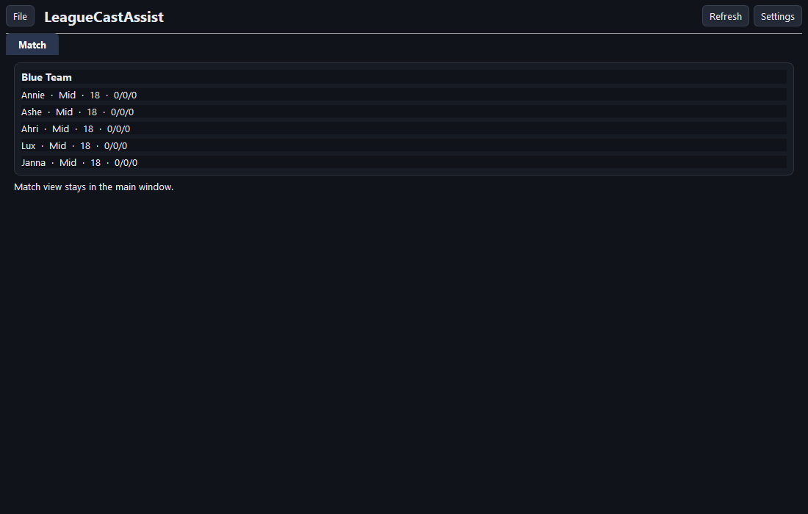
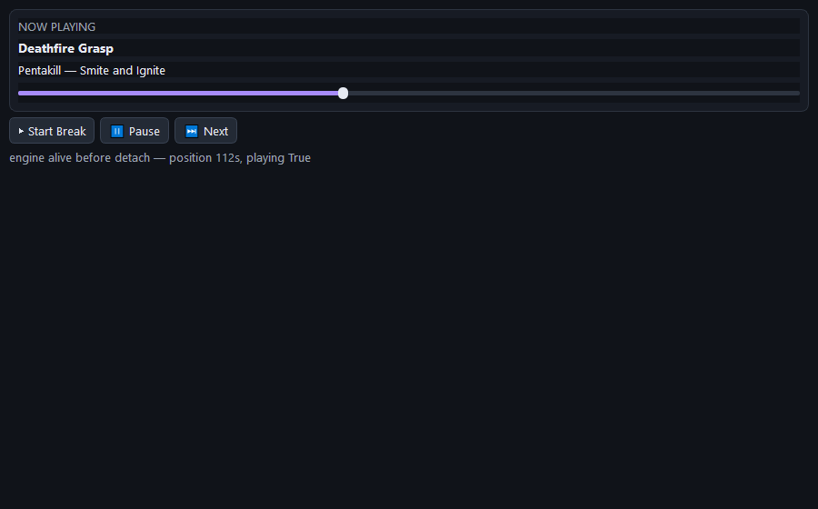
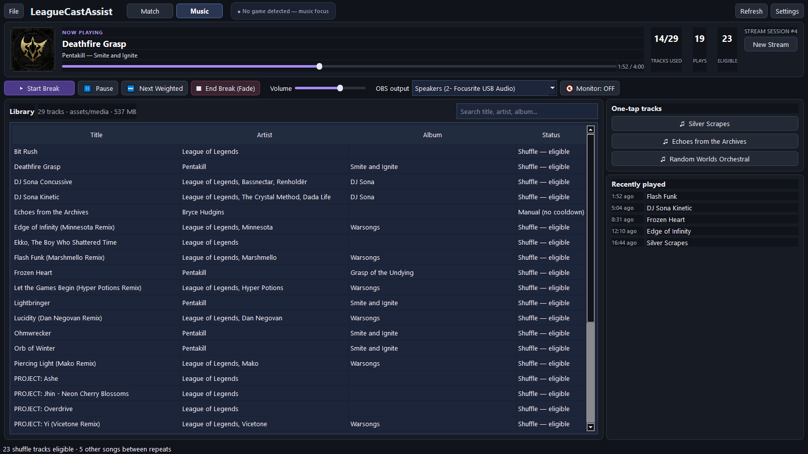
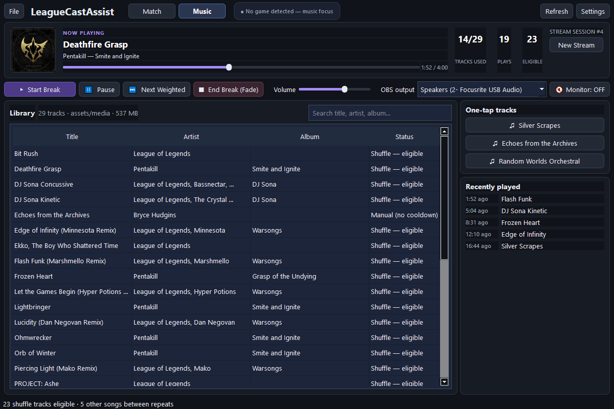
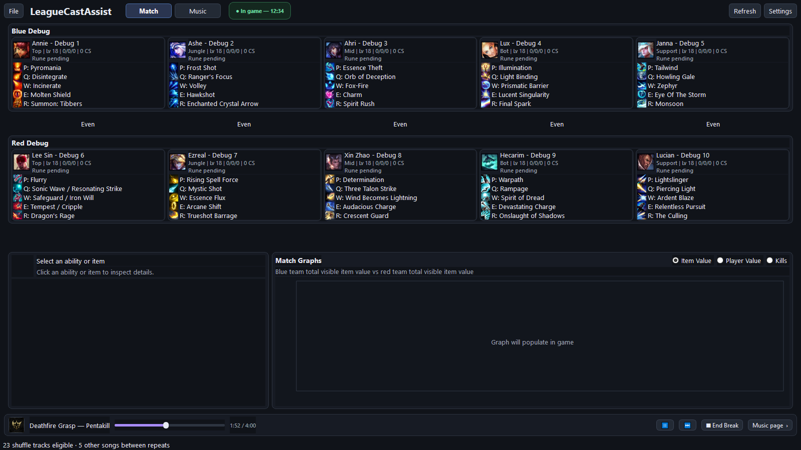

# Music Player Integration — Implementation Plan

| Field | Value |
|---|---|
| Document Type | Implementation Plan (for approval) |
| Repository | LeagueCastAssist |
| Status | **Implemented — Phases 0–5 complete, including packaged-build validation** |
| Target Version | 0.6.0 (new feature / visible change) |
| Prepared Against | `main` @ `54728a0` (v0.5.5), `music_player.py` @ sha256 `9c87725c`, `music.db` @ sha256 `3e6b4e9d` |
| Companion Docs | `DESIGN.md`, `docs/ARCHITECTURE.md`, [`media-manifest-spec.md`](media-manifest-spec.md) |

---

## 0. Implementation Status (as built)

Branch `feat/music-integration`, version `0.6.0`. Phases 0–4 are implemented; Phase 5 (PyInstaller build
validation) is the remaining gate.

| Area | Landed |
|---|---|
| Config | `MusicSettings`, `FocusSettings`, `CatalogSettings` with defaults (old `settings.json` still loads) |
| Theme | `ui/theme.py` applied via `QApplication.setStyleSheet` — detached windows stay styled |
| Music core | `music/library.py` (migrations, WAL, seeding, degraded mode), `music/selection.py` (pure rules), `music/playback.py` (dual output + fade), `music/models.py` (manifest models), `music/catalog.py` (stub sync) |
| Shell | `ui/main_window.py` (tabs, auto-focus, auto-start, strip, overlay), `ui/match_page.py` (extracted), `ui/detachable_tabs.py` (tear-off + re-dock + geometry restore) |
| Music UI | `ui/music_page.py`, `ui/music_strip.py`, `ui/now_playing_window.py`, `ui/media_download_dialog.py`, rebuilt 5-tab `ui/settings_dialog.py` |
| Detection | `data/game_activity.py` (`GAME_STARTED` / `GAME_ENDED` with grace period) |
| Seed | `music/seed/music.db` copied to `music.db` on first run; wired into `build.ps1` + `LeagueCastAssist.spec` |
| Tests | 140 passing (91 existing + 49 new: selection, library, activity, catalog, detachable tabs, seed validation) |
| Packaging | `dist/LeagueCastAssist.exe` builds and runs (74.1 MiB, +9.4 MiB over 0.5.5 for QtMultimedia/FFmpeg); the frozen app seeds its library from the bundled `music.db` and logs `Playback engine ready: 3 audio output(s)` |

Verified with a scripted acceptance run (silent audio, volume 0) — outputs in `docs/plans/images/qa-*.png`:

```
[1] idle -> Music page
[2] live game -> Match page, pill "● In game — 12:34"
[3] playback -> engine playing, strip visible on Match page
[5] detach -> 1040x640 window, playback continues, redock restores 2 tabs
[6] game end -> Music page after grace period, pill "● EndOfGame — music focus"
```

Run it locally with the repo venv (`python -m league_cast_assist.app`) — no League client is required to see
the pages, the library and the settings.

The packaged build (`dist/LeagueCastAssist.exe`, 74.1 MiB) was started from a clean state and logged
`Seeded music library from …\_MEI…\music.db` followed by
`Playback engine ready: 3 audio output(s), default=Speakers (2- Focusrite USB Audio)`, and then began its
CommunityDragon fetch. The 500×200 OBS surface keeps its capture contract:




---

## 1. Executive Summary
`music_player.py` is a **single-file PySide6 "Riot music producer" app** (739 lines) with its own SQLite
library (`music.db`) and a 500×200 OBS "Now Playing" overlay. It is a natural second screen for this app:
casters play break music between games and need champion/item data during games.

**Compatibility verdict: compatible, no dependency conflict.** Both are PySide6 6.x / Python 3.11+ desktop
apps; the handed-over `PySide6==6.12.0` pin is satisfied by this project's existing `PySide6>=6.7,<7.0`, and
`QtMultimedia` already ships inside the `PySide6` meta-package. **Net dependency change: zero.**

The work is a **restructure**, not a merge of event loops: the music player becomes a second page inside
the existing `MainWindow`, its audio engine is extracted from its `QMainWindow` into a non-visual
controller, and the two pages become **detachable tabs**.

Confirmed behaviour driving the design:

1. **No active game → music page takes focus** (switch page **and** raise the window; both toggleable).
2. **Game detected → match/champion page takes focus** (switch page **and** raise the window; both
   toggleable).
3. Music **comes into view only** by default; optional **auto-start after N seconds** (configurable input).
4. One window by default, with **tab tear-off** into an independent window (feasibility verified, §3.4).
5. A compact **in-match music strip** so the caster can control music without leaving the champion screen.
6. Media is **not** distributed by the app; it is downloaded from a central domain (stub now, URL later).

---

## 2. Compatibility Analysis

### 2.1 Stack comparison

| Concern | LeagueCastAssist (existing) | `music_player.py` (incoming) | Verdict |
|---|---|---|---|
| GUI toolkit | PySide6 `QtWidgets` | PySide6 `QtWidgets` + `QtMultimedia` | ✅ Same major; `QtMultimedia` in `PySide6-Addons`, already pulled in |
| Python | 3.11+ | 3.11+ (`X \| None` syntax) | ✅ |
| HTTP | `httpx` async, explicit timeouts | none (local SQLite only) | ✅ Keep `httpx`; do **not** import `requests` |
| Config | pydantic `AppSettings` + `settings.json` | module-level constants, hard-coded `ROOT` | ⚠️ Refactor into `AppSettings` |
| Persistence | JSON settings, `assets/` cache | SQLite `music.db`, `music/`, `artwork/` | ⚠️ Needs path resolution + local seed |
| Threading | `QThread` + `Signal` workers | `QMediaPlayer` + `QTimer` on GUI thread | ✅ Audio stays on GUI thread |
| Styling | `MainWindow.setStyleSheet` (`main_window.py:734`) | own stylesheet on its `QMainWindow` | ⚠️ Must become **application-level** styling (required for tear-off, §3.4) |
| Packaging | PyInstaller onefile, `--windowed` | plain script | ⚠️ Verify QtMultimedia/FFmpeg plugins in the built exe |
| Tests / lint | pytest (91 passing), ruff (100 cols) | none | ⚠️ New code arrives with tests |

### 2.2 Handed-over requirements pin review

| Pin | Action |
|---|---|
| `PySide6==6.12.0`, `PySide6_Essentials`, `PySide6_Addons`, `shiboken6` | ✅ Satisfied; 6.12.0 installed and verified with QtMultimedia/FFmpeg 9.0.1 |
| `PySide6_WebEngine`, `PySide6_Pdf` | ❌ Not needed (~200 MB of exe weight) |
| `requests`, `urllib3`, `certifi`, `charset-normalizer`, `idna` | ❌ Violates ARCHITECTURE §4.3 (httpx only) |
| `gevent`, `greenlet`, `zope.*`, `cffi`, `pycparser` | ❌ Not needed |
| `websocket-client` | ❌ Not needed now |
| `mutagen` | ⏸ Only for future MP3 import/tag reading; manifest carries metadata |

### 2.3 Code-shape conflicts and how they are resolved

| Conflict | Resolution |
|---|---|
| `MusicWindow.__init__` raises `RuntimeError` / modal when `music.db` or songs are missing | Pages never raise. Empty state + "Download media" CTA. (Reproduced for real: a read-only `music.db` kills the standalone app with `attempt to write a readonly database` before it draws) |
| `ensure_tables()` creates/back-fills tables on every launch | Moves to `music/library.py:migrate()`, idempotent + transactional + tested |
| `sqlite3.connect` without timeout; external Twitch bot writes `votes` | `PRAGMA journal_mode=WAL`, `busy_timeout=5000`, read-only vote access, tolerate a missing `votes` table |
| Widgets, audio, DB, and session logic welded into one `QMainWindow` | Split into `MusicPage` (view), `PlaybackEngine` (audio), `MusicLibrary` (data) |
| Its stylesheet overrides the app theme; a reparented page loses a window-level stylesheet | Single `ui/theme.py` stylesheet applied via `QApplication.setStyleSheet` |
| Vertical stack of full-width rows wastes 1600 px (§3.2) | Two-column layout: library left, one-tap/history sidebar right (§4.2) |
| Track paths relative to the script | Resolve against `media_root()`; DB rows stay `music/…`, `artwork/…` |
| Overlay shown unconditionally at startup | Created lazily, hidden unless enabled in Settings |
| Modal `QMessageBox` for a missing file | Non-modal status + auto-skip; modal only when the whole library is missing |

---

## 3. Current State and Feasibility Evidence

### 3.1 Existing match/champion screen



Header: `File ▾ · LeagueCastAssist · … · Refresh · Settings`. No navigation exists yet — this is where the
tab bar lands.

### 3.2 Standalone music player



Every control is a full-width row, so the library is squeezed into the bottom third and ~40 % of the width
is empty. Status is duplicated (counter + status bar) and "Repeat ready (9 …)" truncates.



The 500×200 overlay contract (OBS Window Capture) is preserved exactly — size, page flip, 15 s / 5 s
timings.

### 3.3 Supplied media inventory (verified on this machine)

| Item | Value |
|---|---|
| Tracks | **29** — 24 MP3 + 5 WAV (PCM 44.1/48 kHz) |
| Total audio | **537.6 MB** (512.7 MiB); largest single file 61.6 MB (`Echoes in The Archives.wav`) |
| Artwork | **10** JPEGs, 0.6 MB (albums share art) |
| DB coverage | **29/29** `file_path` and **10/10** `artwork_path` resolve → supplied `music.db` works **verbatim**, zero row edits |
| `votes` table | absent in the supplied DB (created by the Twitch bot) → must be tolerated |
| Formats | MP3 + WAV both verified playing through QtMultimedia/FFmpeg 9.0.1; reported durations match DB values (e.g. Bit Rush 151.25 s) |
| Distribution | **Local seed only.** Not bundled in the exe, not served by the app; final source is the central domain |

Mixed MP3/WAV matters for two reasons: the exe must ship the FFmpeg multimedia plugin, and download
progress must be **byte-based** (537 MB with one 61.6 MB file), not file-count-based.

### 3.4 Detachable tabs — feasibility spike (run, not theorised)

Qt has **no built-in tab tear-off** for `QTabWidget`. Two viable routes:

| Route | Mechanics | Pros | Cons |
|---|---|---|---|
| **A. `QDockWidget`** | Wrap each page in a dock; Qt floats it on title-bar drag and re-docks on edge drop | Free tear-off/re-dock, ~20 LOC | Dock-shaped UX, not tab-shaped; the *title bar* is the drag handle, not the tab; dock chrome needs styling; edge-drop re-dock feels different from closing |
| **B. `QTabWidget` + tab-bar event filter** | Press on `tabBar().tabAt()`, arm after 40 px, on release outside the tab bar `removeTab()` → reparent the page into a `QMainWindow`; closing that window re-docks | Exactly the requested gesture; tabs keep the app look; full control of focus/persistence | ~150–200 LOC; theme, visibility, focus and persistence details must be handled explicitly |

**Decision: route B**, and it has been validated with a running spike on PySide6 6.12.0.

Main window after tearing the Music tab off — the tab is gone, Match remains, tabs are themed:



The torn-off page, fully styled and functional, with shared state intact:



Spike output:

```
detached windows: 1
tab count after detach: 1
engine position preserved: 112 playing: True
tab count after redock: 2
```

**Engineering requirements this spike proved (all non-obvious, all cheap if designed in up front):**

1. **Theme must be application-level.** A page reparented into another window does **not** inherit the
   main window's `setStyleSheet`. Extract `MainWindow._apply_dark_theme()` into `ui/theme.py` and call
   `QApplication.setStyleSheet()` in `app.py`. Without this, the detached window renders unstyled.
2. **The audio engine must live outside the page.** `PlaybackEngine` and `MusicLibrary` are owned by the
   shell/controller and injected into `MusicPage`. If they were children of the page, tearing off would
   destroy and recreate `QMediaPlayer`s — audio would stop. The spike kept a shared engine object and
   observed `position 112s, playing True` across the detach.
3. **Reuse the widget instance, never recreate it**: `removeTab()` → `setParent(None)` →
   `setCentralWidget()` → **`page.show()`**. A widget removed from a tab stays hidden; omitting the
   `show()` produced a blank window (observed, then fixed).
4. **Re-dock on close.** `DetachedWindow.closeEvent` re-inserts the page at its remembered index, so a
   page can never be lost. Plus `File ▸ Re-dock Music Page` and `Ctrl+Shift+D`.
5. **Persistence**: `music.detached: bool` + `music.detached_geometry: [x, y, w, h]`; on restore, validate
   against `QGuiApplication.screens()` and fall back to centered-on-primary if the monitor is gone.
6. **Auto-focus targets the host, not the tab.** If the music page is detached, "bring music to focus"
   means `raise_()` + `activateWindow()` on the detached window; switching tabs is a no-op for it.
7. **Detached window needs its own affordances.** The app header (File/Settings) stays in the main window,
   so give the detached window a compact `⤢ Dock` / `Settings…` menu and keep transport controls in the
   page itself (they travel with it).
8. **The OBS overlay stays independent** — never dockable; stable window title so OBS keeps the same
   capture source: `LeagueCastAssist — Now Playing (OBS)`.

**Cost:** ~150–200 LOC (`ui/detachable_tabs.py`) + `QTest` drag simulation + settings persistence ≈
**1–1.5 days**, inside Phase 2. Drag-back-to-tab-bar re-dock is deliberately deferred (close-to-redock is
the documented path); it is the only part that would need real drag-and-drop plumbing.

---

## 4. Proposed User Experience

### 4.1 Navigation: tabs in one window, tear-off on demand

```
File ▾   LeagueCastAssist   [ Match ][ Music ]   ● In game — 12:34            [Refresh] [Settings]
```

* The tab bar sits where the segmented nav was; `Match` / `Music` are ordinary tabs (`setMovable(True)`).
* **Drag the `Music` tab off the bar** (40 px threshold, released outside the tab bar) → it becomes its own
  window; the main window keeps only `Match`.
* Close the detached window (or `Ctrl+Shift+D`) → it re-docks.
* The state pill shows what auto-focus is doing: `● No game detected — music focus`, `● In game — 12:34`,
  `● League client not connected`, `● Debug simulation`.
* `Refresh` is match-only; `Ctrl+1` / `Ctrl+2` switch pages; `Space` = pause/resume on the Music page.

### 4.2 Proposed Music page



1. **Now-playing card** — real artwork, title, artist/album, seek bar, position/duration; right side shows
   stream-session stats (tracks used, plays, eligible) and `New Stream`.
2. **Transport row** — `▶ Start Break`, `⏸ Pause`, `⏭ Next Weighted`, `■ End Break (Fade)`, volume, OBS
   output device, producer-monitor toggle. One row, never scrolls.
3. **Library card** — `29 tracks · assets/media · 537 MB`, search box, sortable table
   (Title / Artist / Album / Votes / Status). *Note: the mock omits the `Votes` column because the supplied
   `music.db` has no `votes` table; the shipped UI keeps it.*
4. **Sidebar** — `One-tap tracks` (Silver Scrapes / Echoes / Random Worlds) and `Recently played`.

At the realistic floor (1200×800; the app's default is 1050×800):



Below ~980 px the sidebar collapses (history hides, one-tap becomes an overflow menu).

### 4.3 Proposed Match page



Only the header row and the new music strip change; team/graph content is untouched.

### 4.4 Auto-focus behaviour specification

State comes from the `MatchState` already delivered to `MainWindow._update_state()` every poll
(`source` ∈ `none | lcu | liveclient | debug`, `phase`, `game_time_seconds`). **No new polling.**

| Condition | Meaning | Auto action (when enabled) |
|---|---|---|
| `source == "liveclient"` | A game is being spectated right now | → Match page |
| `phase == "InProgress"` (live API not up yet) | Loading screen | → Match page |
| Everything else | Lobby, champ select, client closed, game over | → Music page (after grace period) |
| `source == "debug"` | Debug simulation | Never auto-switch |
| Launch mid-game | First state already in-game | Stay on Match, no flash |

Anti-twitch rules:

* **Transition-driven, not state-driven.** Fires only when `in_game` flips, so a manual tab switch during
  a game is respected until the next transition.
* **Hysteresis**: `in_game → idle` must hold for `idle_return_delay_seconds` (default 8 s), so loading
  screens, reconnects and spectator lag do not pull the user out of the match view.
* **Never while a modal is open**, and never during debug simulation.
* **Switch and raise are independent toggles** (your answer: both on by default). If the music page is
  detached, "raise" targets the detached window.
* **Neither action ever starts audio** — see §4.6.

### 4.5 Optional auto-start (approved)

Settings:

```
[ ] Start music automatically when a game ends
    Start after [ 60 ] seconds        (0–600, spin box)
```

Behaviour: on `GAME_ENDED`, if enabled, start a countdown timer. On expiry — and only if no game has
started meanwhile — call the same `next_weighted()` that `Start Break` uses (so cooldowns and vote
weighting still apply). The countdown is visible and cancellable in both the Music page status area and the
in-match strip (`Starting music in 42 s · Cancel`). Starting a game cancels it. Default: **off**, so a
fresh install never surprises anyone.

### 4.6 In-match music strip (approved)

A 44 px strip directly above the status bar on the Match page, visible only while music is playing or
paused:

```
[art] Deathfire Grasp — Pentakill   ▬▬▬▬▬────  1:52 / 4:00      [⏸] [⏭] [■ End Break]  [Music page ›]
```

* Artwork thumb (32 px), elided title/artist, thin progress bar, time.
* `⏸` / `⏭` / `■ End Break` mirror the transport.
* `Music page ›` jumps to the Music tab (or raises the detached window).
* When a game starts and music is playing, the strip is the only music surface on the Match page — no
  panels, no layout reflow.
* Toggleable in Settings (`music.in_match_strip`, default on).

### 4.7 Settings additions ("Music & Focus")

```
Music & Focus
─────────────────────────────────────────────────────────────
When no game is running        [x] Show the Music page
                               [x] Bring the window to the front
When a game is detected        [x] Show the Match page
                               [x] Bring the window to the front
Return to music after          [ 8 ] seconds without a detected game
                               [ ] Start music automatically, after [ 60 ] seconds
                               [x] Show the 500×200 OBS "Now Playing" window
                               [x] Show the music strip on the Match page
Media folder                   C:\…\assets\media                  [Change…] [Open]
Media source                   [ https://…                       ] [Download / verify now]
                               Last checked: never · 29 tracks · 537 MB
Audio                          Output: [Speakers (2- Focusrite…) ▾]  [ ] Producer monitor
Playback                       Volume ▬▬▬▬▬▬ 65
```

Every control maps 1:1 to a settings key, so manual QA has an unambiguous checklist.

---

## 5. Target Architecture

```
src/league_cast_assist/
  app.py                        + QApplication.setStyleSheet(APP_STYLESHEET)
  config.py                     + MusicSettings, FocusSettings, CatalogSettings
  resources.py                  + media_root(), music_db_path(), bundled_music_db()

  music/                        NEW package
    __init__.py
    models.py                   Song, MediaManifest, MediaTrack (pydantic)
    library.py                  MusicLibrary: migrate(), songs/sessions/play_events/votes
    selection.py                intervening_count(), repeat_eligible(), pick_weighted()  — pure
    playback.py                 PlaybackEngine: dual QMediaPlayer, monitor routing, 30-step fade
    catalog.py                  MediaCatalog: manifest, sha256, atomic download, progress/cancel

  ui/
    theme.py                    NEW — single APP_STYLESHEET (replaces MainWindow._apply_dark_theme)
    detachable_tabs.py          NEW — DetachableTabWidget + DetachedWindow (~150–200 LOC)
    main_window.py              shell: header + tab widget + auto-focus + strip wiring
    match_page.py               (extracted) today's team/graph/detail body
    music_page.py               NEW MusicPage(QWidget)
    music_strip.py              NEW in-match strip
    now_playing_window.py       NEW ported 500×200 OBS overlay
    media_download_dialog.py    NEW download/verify dialog
    settings_dialog.py          + "Music & Focus" section
    workers.py                  + CatalogDownloadWorker (same pattern as StaticDataDownloadWorker)

  data/
    game_activity.py            NEW GameActivityTracker (in-game detection + hysteresis)
```

Ownership that makes tear-off safe:

```
AppShell (MainWindow)
  ├── PlaybackEngine (non-visual, lives for app lifetime)  ──► MusicPage (view) + MusicStrip
  ├── MusicLibrary   (non-visual, sqlite on GUI thread)    ──► MusicPage
  ├── DetachableTabWidget([MatchPage, MusicPage])
  │      └── tear-off → DetachedWindow(MusicPage)   (same instance, same engine)
  └── NowPlayingWindow (independent top-level, OBS)
```

`DataWorker` (QThread) is untouched, so Riot polling isolation and the existing shutdown sequence stay
intact.

---

## 6. Media, Paths, and the Central Domain

### 6.1 Paths (consistent with existing asset handling)

```
<app dir>                      (exe dir when frozen, cwd in dev — same rule as settings.json)
  settings.json
  music.db                     seed library
  assets/
    communitydragon/<ver>/…    existing CDragon cache
    media/
      music/…                  29 tracks  ← song.file_path   (e.g. music/Bit Rush.mp3)
      artwork/…                10 JPEGs   ← song.artwork_path
```

`assets/` is already git-ignored, so media never enters the repository or the exe. For this phase the
supplied zips were extracted into `assets/media/` locally and verified against the DB (§3.3).

### 6.2 Manifest contract (final shape pending the domain)

```json
{
  "schema_version": 1,
  "library_version": "2026.10.25",
  "generated_at": "2026-10-25T00:00:00Z",
  "min_app_version": "0.6.0",
  "tracks": [
    {
      "song_id": 1001,
      "file": "music/Bit Rush.mp3",
      "size_bytes": 6854056,
      "sha256": "…",
      "artwork": "artwork/arcade.jpg",
      "artwork_sha256": "…",
      "title": "Bit Rush",
      "artist": "League of Legends",
      "album": null,
      "album_artist": "League of Legends",
      "duration_seconds": 151.249,
      "playback_mode": "shuffle",
      "group_name": null,
      "source_url": null
    }
  ]
}
```

* `song_id` optional (library keys on `file_path`, already `UNIQUE`).
* `sha256` optional but recommended; mismatch → one re-fetch, then a per-file error.
* Manifest refresh **never overwrites** existing rows, so play history and Twitch votes survive.
* Configurable: `catalog.base_url` (default empty → feature inert, no network) and
  `catalog.manifest` (default `manifest.json`). Working assumption for the final URL:
  `https://<subdomain>.budaslounge.com/media`, later moved to `thearchiveslol.com` — a settings change,
  and the seam `music/catalog.py` protects if the shape changes to an API.

### 6.3 Download behaviour

* Triggered by Settings ("Download / verify now") and by an empty-library prompt.
* `CatalogDownloadWorker(QThread)` with `progress_updated / status_updated / failed / finished` — the same
  shape as `StaticDataDownloadWorker`, so progress/cancel UX is already familiar.
* **Byte-based progress with per-file rows** (537 MB, one 61.6 MB file).
* Per-file `.part` → verify (size + sha256 + JPEG/MP3/WAV header sanity) → atomic rename. Cancel leaves no
  partial accepted files.
* Runs only on explicit user action until the domain exists (`catalog.auto_check` default **false**).

---

## 7. Configuration Schema Change

New sections only — pydantic defaults mean an existing v0.5.5 `settings.json` keeps working with no
migration code (ARCHITECTURE CRITICAL covers *removed/renamed* keys; we only add).

```json
{
  "music": {
    "volume": 65,
    "monitor_enabled": false,
    "stream_device_id": "",
    "overlay_enabled": true,
    "in_match_strip": true,
    "media_dir": "",
    "detached": false,
    "detached_geometry": null,
    "auto_start_on_game_end": false,
    "auto_start_delay_seconds": 60
  },
  "focus": {
    "show_music_when_idle": true,
    "raise_music_when_idle": true,
    "show_match_in_game": true,
    "raise_match_in_game": true,
    "idle_return_delay_seconds": 8.0
  },
  "catalog": {
    "base_url": "",
    "manifest": "manifest.json",
    "auto_check": false
  }
}
```

The four `focus` booleans are exactly the "configurable in the settings tab" requirement; nothing about the
auto behaviour is hard-coded.

---

## 8. Implementation Phases

| Phase | Scope | Est. | Usable result |
|---|---|---|---|
| **0 — Foundations** | `config.py` (3 sections), `resources.py` paths, `music/library.py` (+WAL, idempotent migrate), `music/selection.py`, **`ui/theme.py` extraction + `QApplication.setStyleSheet`** | 1.5 d | No visible change; detach prerequisite in place |
| **1 — Playback** | `music/playback.py`: dual `QMediaPlayer`, device selection, monitor rule, 30-step fade, `EndOfMedia` advance (shuffle) vs stop (manual), error → status signal, ≤350 ms drift correction | 1 d | Music plays from `assets/media` |
| **2 — Shell, pages, detach, strip** | `match_page.py` extraction; `DetachedTabWidget` + `DetachedWindow` + persistence; `music_page.py`; `music_strip.py`; `now_playing_window.py`; settings wiring | 3.5 d | **QA-ready: the combined UI** |
| **3 — Auto-focus + auto-start** | `game_activity.py` + `AutoFocusController`; switch/raise per setting (host-aware); auto-start countdown; Settings section | 1.5 d | Behaviour per §4.4/§4.5 |
| **4 — Media catalog** | `music/catalog.py`, `music/models.py`, `CatalogDownloadWorker`, `media_download_dialog.py`, Settings media block, empty-state CTA | 2 d | Stub ready for the domain |
| **5 — Hardening, packaging, docs** ✅ | ruff + pytest (140 green); new test suites; PyInstaller multimedia/FFmpeg verification on the built exe; `DESIGN.md` / `ARCHITECTURE.md` / `README.md`; version 0.6.0 | 2 d | Release candidate |

**Total ≈ 11–12 working days**, QA-able after Phase 2 (~6 days).

---

## 9. Testing and QA Plan

| Layer | Coverage |
|---|---|
| Unit | selection maths (incl. "no eligible tracks"), library migration twice, manifest parse/validate, sha256 mismatch, activity transitions, `countdown` cancellation |
| Widget | tear-off via `QTest` drag events, re-dock on close, page identity preserved (same object), theme applied in both windows, strip visibility rules |
| Integration | `MainWindow` with `start_worker=False`, scripted `MatchState` sequences asserting the visible page and raise calls (`QWidget.isActiveWindow` under a `QTest` harness) |
| Manual (yours) | real game via spectator; lobby/idle cycles; OBS capture of the overlay; virtual-cable routing; monitor toggle; tear-off on a second monitor; volume/geometry persistence |

Manual QA script handed over at Phase 2:

1. Launch with no League client → Music page, `No game detected` pill.
2. Spectate a game → Match page within one poll; pill shows `In game`.
3. Leave the game → Music page after 8 s.
4. Click `Music` during a game → stays until the next transition.
5. Untick `Bring the window to the front` for in-game → page still switches, window does not raise.
6. Enable auto-start at 30 s, end a game → countdown visible, music starts, cancel works.
7. Drag the `Music` tab out → separate window, audio continues; close it → re-docks on the correct index.
8. Detach to a second monitor, restart → geometry restored; unplug the monitor, restart → window recentres.
9. In-match strip: pause/next/end-break from the Match page; `Music page ›` raises the right window.
10. Close/reopen → volume, device, monitor state, page preference, and detach state restored.

---

## 10. Packaging and Release Impact

* **Exe size**: measured **74.1 MiB** after the integration (0.5.5 was 64.7 MB), i.e. QtMultimedia + the
  FFmpeg backend cost ~9.4 MiB in the onefile bundle. Verified present in the package:
  `Qt6Multimedia.dll`, `ffmpegmediaplugin.dll`, `avcodec-63.dll` (13.5 MB), `avformat-63.dll`,
  `swresample-7.dll`.
* **Frozen-run evidence**: starting the packaged exe logs
  `Seeded music library from …\_MEI…\music.db` then
  `Playback engine ready: 3 audio output(s), default=Speakers (2- Focusrite USB Audio)`, which is the
  regression signal to watch for if a future build drops the multimedia plugin.
* **Onefile temp extraction**: the default `LeagueCastAssist.exe` is a PyInstaller **onefile** build, so the
  bootloader unpacks the whole bundle (Python + Qt + FFmpeg, ~74 MB) into `%TEMP%\_MEI<pid>` *before* any app
  code runs. A machine whose `%TEMP%` forbids creating directories shows the bootloader's
  `Could not create temporary directory!` dialog; nothing in the app can catch or work around that, because
  Python has not started yet.
  `.\build.ps1 -Portable` builds the same app with `--onedir` into `dist\LeagueCastAssist-portable\`
  (`_internal\` beside a 7.8 MB exe, 164 MB total). Verified: launching it creates `music.db` and the log
  beside the exe and leaves `%TEMP%` untouched, so a portable install really is self-contained.
  Keeping onefile for the GitHub-release updater is a packaging decision, not a product one — the updater
  swaps a single exe path.
* `build.ps1` prefers the repo `.venv\Scripts\python.exe` so the documented local build works on machines
  without a global `python`.
* **Media is never bundled**: 537 MB lives beside the exe in `assets/media`, downloaded from the central
  domain when it exists. The supplied zips are local seed data only and must not be committed or shipped.
* **`LeagueCastAssist.spec` / `build.ps1`**: no new `--add-data` entries; if PyInstaller misses a
  multimedia plugin, `hiddenimports` gets it and both files change together (ARCHITECTURE CRITICAL).
* **Updater unaffected**: `music.db` and `assets/media/` sit beside the exe and survive exe replacement.
* **Backward compatibility**: 0.5.x users get default settings; the Music page shows the empty state until
  media exists, so upgrading never breaks a working install.

---

## 11. Risks and Mitigations

| Risk | Impact | Mitigation |
|---|---|---|
| Auto-switch steals focus mid-game | Disruptive during a live cast | Raise defaults are toggleable; transition-driven switching; manual override respected |
| "Game running" is ambiguous (loading, reconnect, spectate delay) | Page flicker | Hysteresis + 8 s grace; live API as authority; tracker unit tests over recorded sequences |
| **Theme lost in the detached window** | Unstyled window (observed in the spike before `QApplication` styling) | Global stylesheet in Phase 0; widget test asserts styling on both windows |
| **Audio stops when detaching** | Embarrassing live failure | Engine owned by the shell, injected into the page; re-dock closes over the same instance; QA step 7 |
| Detached geometry off-screen after monitor changes | Invisible window | Validate against `QGuiApplication.screens()` on restore |
| QtMultimedia missing from the built exe | Silent audio in release | Phase 5 build-and-play gate; log the multimedia backend at startup |
| Two `QAudioOutput`s on one device | Double audio or silence | Keep the existing "refuse to monitor on the same device" rule + status message |
| 537 MB download on a slow link | Abandoned setup | Byte progress, per-file retry, cancel-safe, deferrable; library usable partially (tracks appear as they land) |
| External Twitch bot writing `votes` | `database is locked` | WAL + busy timeout; reads only |
| Divergence from the upstream standalone script | Two sources of truth | Retire `music_player.py` after parity sign-off; the DB schema is the contract |
| Scope creep (Twitch voting, import tooling) | Slips the plan | Out of scope for 0.6.0 |

---

## 12. Decisions Recorded

| # | Decision | Outcome |
|---|---|---|
| 1 | Window model | **One window** with `Match`/`Music` tabs, **tear-off by dragging the tab**, re-dock on close. Feasible (spike, §3.4), ~1–1.5 d |
| 2 | "Brought to focus" | **Switch page + raise window**, both directions, each toggleable in Settings |
| 3 | Auto-start | **Off by default**; optional auto-start after a configurable number of seconds (spin box) |
| 4 | Media location | **`assets/media/`** — same area as other assets, already git-ignored |
| 5 | Seed library | **Supplied zips used locally**; verified 29/29 tracks + 10/10 artwork; **not distributed** by the app |
| 6 | Domain | **Undecided** — settings-driven `catalog.base_url`, empty for now; likely `budaslounge.com` subdomain, later `thearchiveslol.com` |
| 7 | In-match strip | **In scope** — 44 px strip with artwork, progress, pause/next/end-break, jump-to-page |

### Remaining open item

* **Manifest location and shape** (only blocks Phase 4): the client-side sync is implemented, tested and
  inert until `catalog.base_url` is set. The proposed contract is
  [`media-manifest-spec.md`](media-manifest-spec.md); the URL path plus one sample response are all that is
  still needed.

---

## 13. Out of Scope for 0.6.0

* Twitch chat integration, `!upvote` counting, vote→weight behaviour beyond reading the existing table.
* MP3 import from a folder (`library_import.py` equivalent) and mutagen tag reading.
* Per-track editing UI (title/artist/album/playback mode/group).
* Drag-back-to-tab-bar re-docking (close-to-redock is the documented path).
* Any change to champion/item data, graphs, or updater behaviour.
